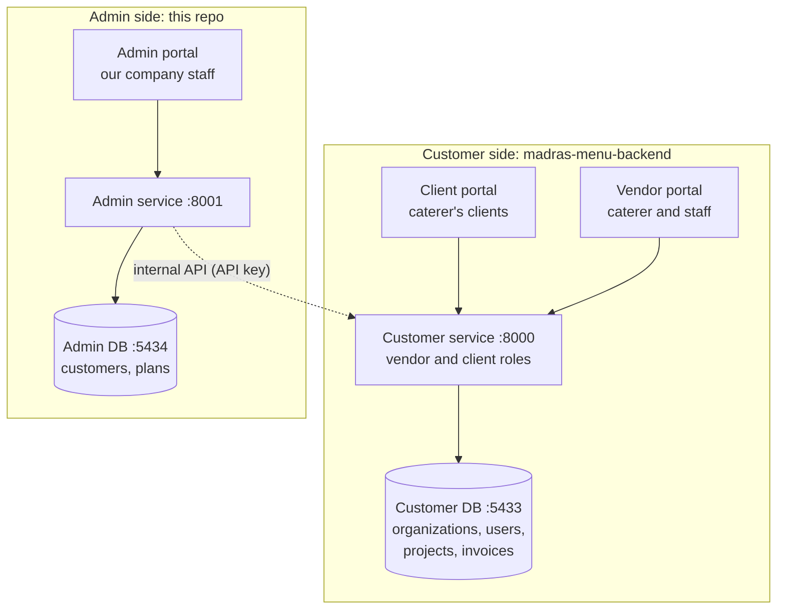
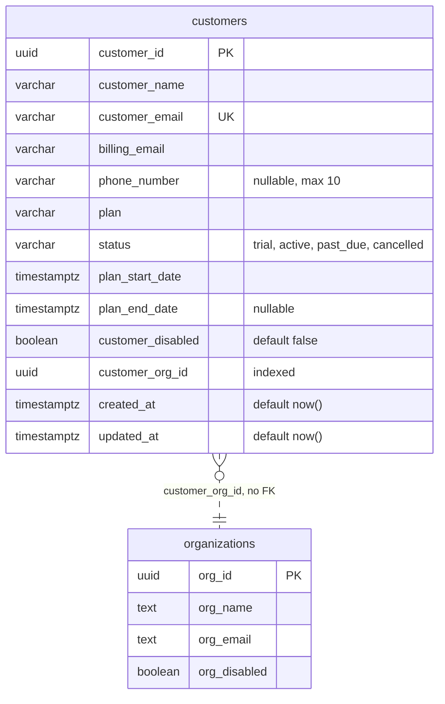

# madras-menu-admin-backend

Backend for the **admin portal**: the dashboard our own staff use to manage the catering companies that subscribe to the Madras Catering app.

Status as of 2026-10-24: the admin API and its own Postgres database start with one `docker compose up`, migrations run through Alembic, and the health checks pass. The first table, `customers`, has a model, a schema and a migration (`55d2f93f7577`); there are no API endpoints for it yet.

## Vocabulary

- **Customer**: a person or catering company that bought a subscription to the app. In the customer app, each customer is one `organizations` row (a tenant).
- **Client**: a customer's own customer (the people a caterer cooks for). Clients use the client portal and never appear in the admin side.
- **Admin staff**: our company's employees, who use the admin portal.

## Three portals, two services, two databases



- A **portal** is a frontend. The client and vendor portals share the **customer service**, because they work on the same data (a vendor creates an invoice, the client accepts that same invoice); roles decide what each person can see and do.
- The admin portal has its **own service and database** (this repo), separate from the customer app.
- The only connection between the two sides is the dashed arrow: the admin service calls an **internal API** on the customer service, authenticated with an API key. It goes in one direction only, so caterers keep working even if the admin side is down.
- The admin service **never connects to the customer database**. It always goes through the customer service.

## Who owns which data

The same company is described in both databases, for different jobs:

| | Customer DB `organizations` | Admin DB `customers` |
|---|---|---|
| Whose view | the caterer's own business profile | our account record for them |
| Edited by | the caterer (Profile page) | our admin staff |
| Read by | the customer app, on every request | the admin portal |
| Examples | name on invoices, timezone, logo, `org_disabled` | plan, status, billing email, `customer_disabled` |

`organizations` stays in the customer DB because everything there hangs off it: projects, users, catalog and invoice documents have foreign keys to `organizations.org_id` (that's how tenants are kept apart), and the app reads it on every request (timezone, invoice headers). Moving it here would turn those foreign keys into unchecked UUIDs and make every customer request depend on the admin service.

The admin DB keeps **no copy** of the customers' operational data (projects, clients, invoices).

## The `customers` table

One row per subscribing caterer: our account record for them. Model `models/customer.py`, schema `schemas/customer.py`, migration `alembic/versions/55d2f93f7577_add_customers.py`.



| Column | Meaning |
|---|---|
| `customer_name`, `customer_email` | who we deal with; the email is unique |
| `billing_email` | where our invoices to them go; required |
| `phone_number` | optional; up to 10 characters |
| `plan` | free text for now; becomes a reference to a `plans` table when pricing tiers arrive |
| `status` | **where they are in the subscription** (the money side): `trial`, `active`, `past_due`, `cancelled` |
| `plan_start_date`, `plan_end_date` | when the current plan runs; no end date means it continues until cancelled |
| `customer_disabled` | **whether staff have locked them out**, set by hand and independent of `status` (for example `active` but disabled after abuse, or `past_due` but still enabled during a grace period) |
| `customer_org_id` | their org in the customer DB (`organizations.org_id`); required |

- **The status values are defined once**, as `CustomerStatus` in `models/choices.py`. The schema uses it for validation (a bad value is a 422), and the model turns it into a database `CHECK` constraint (`customer_status_check`), so scripts and manual SQL can't store a bad value either. To add a status: add it to the enum and write a migration that replaces the constraint.
- **`customer_org_id` has no foreign key**, because a database can't enforce a reference into another database; the code keeps it consistent. `organizations` is shown for context only; it doesn't change.
- **`customer_disabled` is only recorded here for now.** It won't lock anyone out of the customer app until the internal API exists and the customer service checks `org_disabled` (see the roadmap).
- Address, logo, EIN and timezone are deliberately left out: the caterer owns those in the customer DB.

Changing a column from here on means a **new** migration; don't edit `55d2f93f7577` once it has been applied anywhere other than your own machine.

**Open questions:**
1. Should `customer_name` stay in sync with `org_name`, or can they differ (legal name vs trading name)?
2. Does sales create the customer first, or does self sign-up create both rows?
3. What does "app info" include: plans, a feature catalog, app versions?
4. Will payments go through a provider such as Stripe (add `stripe_customer_id`)?
5. Should every existing org get a customer row, including our own platform org?

**Later:** a `plans` table (pricing tiers), `admin_users` (staff logins; `platform_admin` moves here from the customer service), per-customer feature switches, and an audit log of admin actions.

## Running it locally

Needs Docker Desktop. The customer stack can run at the same time: the ports and container names don't clash.

```bash
cp .env.example .env        # then fill in SECRET_KEY: openssl rand -hex 32
docker compose up -d --build
curl localhost:8001/db/health   # {"status":"ok"}
```

| Service | What it does | On your Mac |
|---|---|---|
| `admin-postgres` | Postgres 16, database `madras_admin_local` | `localhost:5434` |
| `admin-migrate` | runs `alembic upgrade head` once, then exits | |
| `admin-api` | the FastAPI app; starts only if the migration succeeded | `localhost:8001` |

Inside Docker, the database host is the service name (`admin-postgres:5432`); from your Mac it's `localhost:5434`. Service names start with `admin-` so this file can later be combined with the customer stack's compose file (`include:`) without name clashes.

Health checks: `GET /` (the process is up; used by the Dockerfile `HEALTHCHECK`) and `GET /db/health` (the database is reachable).

## Configuration

Settings come from environment variables, validated at startup by `config.py`; the app refuses to start with a missing or invalid setting. See `.env.example` for the full list. Required: `DATABASE_URL` and `SECRET_KEY` (at least 32 characters).

## Migrations

Alembic reads the database URL from `DATABASE_URL` (through `config.database_url()`), not from `alembic.ini`.

| Revision | What it does |
|---|---|
| `5127845db22c` baseline | nothing (gives Alembic a starting point) |
| `55d2f93f7577` add customers | creates `customers`, its status `CHECK` and the `customer_org_id` index |

To add a table: define the model on `database.Base`, add it to `models/__init__.py` (that's how `alembic/env.py`'s `import models` sees it; without it autogenerate produces an empty migration), then, with the database running, from your Mac:

```bash
DATABASE_URL=postgresql+psycopg2://postgres:<password>@localhost:5434/madras_admin_local \
  alembic revision --autogenerate -m "describe the change"
```

Read the generated file before committing it: autogenerate can miss things. `docker compose up -d --build` applies it (the `admin-migrate` service runs `alembic upgrade head`).

## Roadmap

- [x] Admin service and database running locally (skeleton, Alembic baseline, health checks)
- [x] `customers` table: model, schema, status constraint, migration
- [ ] Customer endpoints in the admin API (list, create, update, disable)
- [ ] Internal API with an API key on the customer service (first endpoint: list organizations)
- [ ] Disabling a customer locks them out of the customer app (the internal API sets `org_disabled`; the customer service enforces it, which it doesn't yet)
- [ ] Admin staff logins (`admin_users`), moving `platform_admin` out of the customer service
- [ ] Tests (`tests/test_health.py`) and a 503 response when the database is down
- [ ] Deployment on GCP (Cloud Run and Cloud SQL), not yet planned in detail
