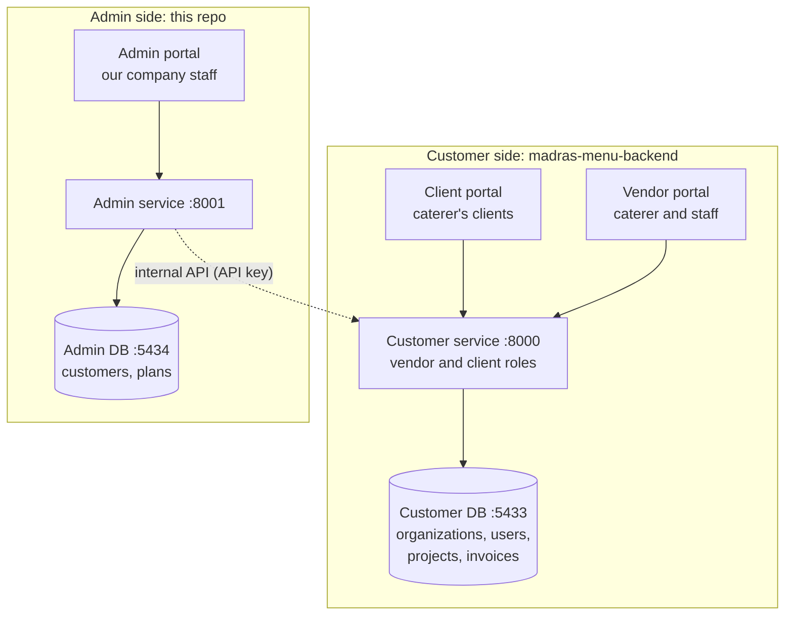
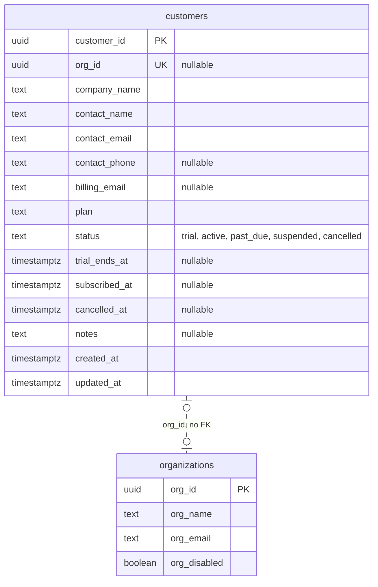

# madras-menu-admin-backend

Backend for the **admin portal**: the dashboard our own staff use to manage the catering companies that subscribe to the Madras Catering app.

Status as of 2026-10-24: a running skeleton. The admin API and its own Postgres database start with one `docker compose up`, migrations run through Alembic (an empty baseline), and the health checks pass. **There are no tables yet**: the `customers` table below is a proposal waiting for review.

## Vocabulary

- **Customer**: a person or catering company that bought a subscription to the app. In the customer app, each customer is one `organizations` row (a tenant).
- **Client**: a customer's own customer (the people a caterer cooks for). Clients use the client portal and never appear in the admin side.
- **Admin staff**: our company's employees, who use the admin portal.

## Three portals, two services, two databases



- A **portal** is a frontend. The client and vendor portals share the **customer service**, because they work on the same data (a vendor creates an invoice, the client accepts that same invoice); roles decide what each person can see and do.
- The admin portal has its **own service and database** (this repo), separate from the customer app.
- The only connection between the two sides is the dashed arrow: the admin service calls an **internal API** on the customer service, authenticated with an API key. It goes in one direction only, so caterers keep working even if the admin side is down.
- The admin service **never connects to the customer database**. It always goes through the customer service.

## Who owns which data

The same company is described in both databases, for different jobs:

| | Customer DB `organizations` | Admin DB `customers` |
|---|---|---|
| Whose view | the caterer's own business profile | our account record for them |
| Edited by | the caterer (Profile page) | our admin staff |
| Read by | the customer app, on every request | the admin portal |
| Examples | name on invoices, timezone, logo, `org_disabled` | plan, status, billing contact, notes |

`organizations` stays in the customer DB because everything there hangs off it: projects, users, catalog and invoice documents have foreign keys to `organizations.org_id` (that's how tenants are kept apart), and the app reads it on every request (timezone, invoice headers). Moving it here would turn those foreign keys into unchecked UUIDs and make every customer request depend on the admin service.

The admin DB keeps **no copy** of the customers' operational data (projects, clients, invoices).

## Proposed: the `customers` table (not built, pending review)



- `organizations` is the customer DB's table, shown for context; it doesn't change.
- `org_id` links the two. It's a plain UUID with **no foreign key**, because a database can't enforce a reference into another database; the code keeps it consistent. It's nullable so a customer can exist before their workspace does, and unique so one customer has at most one org.
- Address, logo, EIN and timezone are deliberately left out: the caterer owns those in the customer DB.

**Open questions:**
1. Should `company_name` stay in sync with `org_name`, or can they differ (legal name vs trading name)?
2. When staff set `status = suspended`, should that set `org_disabled` in the customer app (an internal API call)?
3. Does sales create the customer first, or does self sign-up create both rows?
4. What does "app info" include: plans, a feature catalog, app versions?
5. Will payments go through a provider such as Stripe (add `stripe_customer_id`)?
6. Should every existing org get a customer row, including our own platform org?

**Later:** a `plans` table (pricing tiers), `admin_users` (staff logins; `platform_admin` moves here from the customer service), per-customer feature switches, and an audit log of admin actions.

## Running it locally

Needs Docker Desktop. The customer stack can run at the same time: the ports and container names don't clash.

```bash
cp .env.example .env        # then fill in SECRET_KEY: openssl rand -hex 32
docker compose up -d --build
curl localhost:8001/db/health   # {"status":"ok"}
```

| Service | What it does | On your Mac |
|---|---|---|
| `admin-postgres` | Postgres 16, database `madras_admin_local` | `localhost:5434` |
| `admin-migrate` | runs `alembic upgrade head` once, then exits | |
| `admin-api` | the FastAPI app; starts only if the migration succeeded | `localhost:8001` |

Inside Docker, the database host is the service name (`admin-postgres:5432`); from your Mac it's `localhost:5434`. Service names start with `admin-` so this file can later be combined with the customer stack's compose file (`include:`) without name clashes.

Health checks: `GET /` (the process is up; used by the Dockerfile `HEALTHCHECK`) and `GET /db/health` (the database is reachable).

## Configuration

Settings come from environment variables, validated at startup by `config.py`; the app refuses to start with a missing or invalid setting. See `.env.example` for the full list. Required: `DATABASE_URL` and `SECRET_KEY` (at least 32 characters).

## Migrations

Alembic reads the database URL from `DATABASE_URL` (through `config.database_url()`), not from `alembic.ini`. The first revision, `5127845db22c_baseline`, is empty. To add a table later: define the model on `database.Base`, import it in `alembic/env.py`, then

```bash
alembic revision --autogenerate -m "add customers"
```

and review the generated file before committing it.

## Roadmap

- [x] Admin service and database running locally (skeleton, Alembic baseline, health checks)
- [ ] `customers` table, after the fields are reviewed
- [ ] Internal API with an API key on the customer service (first endpoint: list organizations)
- [ ] Admin staff logins (`admin_users`), moving `platform_admin` out of the customer service
- [ ] Tests (`tests/test_health.py`) and a 503 response when the database is down
- [ ] Deployment on GCP (Cloud Run and Cloud SQL), not yet planned in detail
